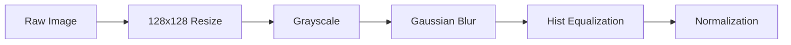
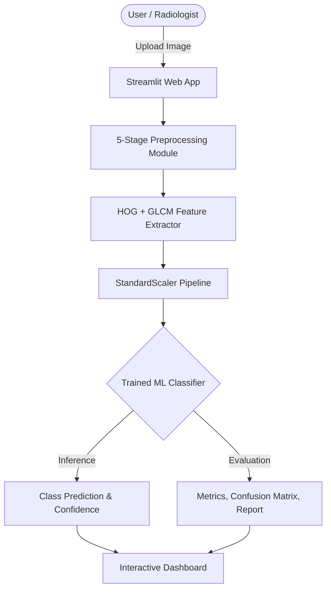

# ACADEMIC PROJECT DOCUMENTATION

## PROJECT TITLE:
**KIDNEY DISEASE IMAGE CLASSIFICATION USING MACHINE LEARNING**

---

### ⚠️ IMPORTANT MEDICAL SAFETY NOTICE:
> **Educational & Academic Notice:** This project is developed strictly for academic demonstration and computer vision research. It is **NOT** a certified medical device and must **NEVER** be used for clinical diagnosis, patient screening, or medical decision-making. Predictions are generated according to mathematical patterns learned from dataset distributions. Consult a qualified healthcare professional for medical advice.

---

## 1. AIM
To design, implement, and validate a comprehensive, interpretable, full-stack Machine Learning web application capable of classifying kidney ultrasound images into diagnostic categories (e.g., Normal, Cyst, Stone, and Tumor) through traditional digital image processing, hybrid feature engineering (HOG + GLCM), and classical machine learning algorithms.

---

## 2. OBJECTIVE
1. To develop an automated 5-stage image preprocessing pipeline that standardizes resolution, suppresses ultrasound speckle noise, and enhances anatomical tissue boundaries.
2. To extract rich multi-descriptor feature vectors by coupling **Histogram of Oriented Gradients (HOG)** for structural shape/edge orientations with **Gray-Level Co-occurrence Matrix (GLCM)** for second-order statistical micro-texture properties.
3. To train and benchmark multiple traditional Machine Learning classifiers: **Support Vector Machine (SVM)**, **Random Forest (RF)**, and **K-Nearest Neighbors (KNN)** within a standardized Scikit-Learn pipeline.
4. To evaluate model performance using rigorous statistical metrics (Accuracy, Weighted Precision, Weighted Recall, Weighted F1-Score, Confusion Matrix heatmaps, and per-class classification reports).
5. To provide an interactive, all-in-one Streamlit dashboard that visualizes all intermediate steps of the ML pipeline for educational demonstration and transparent interpretation.

---

## 3. PROBLEM STATEMENT
Renal pathologies—including nephrolithiasis (kidney stones), renal cysts, and neoplasms (tumors)—affect millions globally. Ultrasound imaging is the preferred frontline diagnostic imaging modality due to its non-invasiveness, lack of ionizing radiation, and cost-effectiveness. However:
- Ultrasound images inherently suffer from low signal-to-noise ratios, acoustic attenuation artifacts, and Rayleigh-distributed speckle noise.
- Manual interpretation requires extensive radiologist expertise and is subject to inter-observer variability.
- While deep learning approaches achieve high accuracy, they operate as uninterpretable "black-boxes" demanding massive computational power.

There is a critical academic need for an open, transparent, and modular system demonstrating how **traditional machine learning algorithms** and **interpretable computer vision features** can analyze ultrasound scans accurately without requiring heavy deep neural networks.

---

## 4. EXISTING SYSTEM VS. PROPOSED SYSTEM

### 4.1 Existing Systems
- **Manual Radiographic Assessment:** Relies entirely on subjective human visual inspection, resulting in potential diagnostic delays or fatigue-induced misinterpretation.
- **Deep Learning / Black-Box CNNs:** Require millions of parameters, massive GPU hardware, and obscure the exact visual or statistical features driving the classification.
- **Fragmented Codebases:** Most research projects provide standalone scripts without an accessible, unified web interface for interactive experimentation.

### 4.2 Proposed System
- **Classical & Interpretable ML:** Employs explicit feature extraction (HOG edge gradients + GLCM texture properties) where every feature corresponds to concrete mathematical properties.
- **5-Stage Preprocessing Pipeline:** Integrates spatial resizing, grayscale conversion, Gaussian smoothing, histogram equalization, and min-max normalization.
- **Multi-Algorithm Flexibility:** Enables real-time switching and hyperparameter tuning across SVM, Random Forest, and KNN.
- **Unified One-Page Dashboard:** Provides complete end-to-end transparency inside a modern Streamlit application.
- **Built-In Synthetic Ultrasound Generator:** Allows out-of-the-box UI demonstration without forcing large external data downloads.

---

## 5. SYSTEM REQUIREMENTS

### 5.1 Software Requirements
- **Operating System:** Windows 10/11, Linux (Ubuntu 20.04+), or macOS
- **Programming Language:** Python 3.10, 3.11, 3.12, 3.13, or 3.14
- **Web Framework:** Streamlit (v1.30.0+)
- **Core ML Library:** Scikit-Learn (v1.3.0+)
- **Computer Vision Libraries:** OpenCV-Python (v4.8.0+), Scikit-Image (v0.21.0+), Pillow (v10.0.0+)
- **Numerical & Data Processing:** NumPy, Pandas, SciPy
- **Data Visualization:** Matplotlib, Seaborn
- **Model Serialization:** Joblib

### 5.2 Hardware Requirements
- **Processor:** Intel Core i3 / AMD Ryzen 3 or higher (Quad-core recommended)
- **RAM:** Minimum 4 GB (8 GB recommended)
- **Storage:** 500 MB free hard disk space for code, synthetic datasets, and serialized models
- **Display:** Minimum $1280 \times 720$ screen resolution

---

## 6. TECHNOLOGIES USED

| Technology | Purpose in Project |
|---|---|
| **Python** | Core implementation language for algorithms, pipelines, and scripts |
| **Streamlit** | Interactive, reactive frontend web dashboard with real-time UI controls |
| **OpenCV (`cv2`)** | Image decoding, spatial interpolation, Gaussian filtering, and histogram equalization |
| **Scikit-Image (`skimage`)** | Multi-orientation HOG feature computation and GLCM co-occurrence matrix generation |
| **Scikit-Learn (`sklearn`)** | Classifiers (SVM, Random Forest, KNN), StandardScaler, Pipeline, Train/Test split, and metrics |
| **Pillow (`PIL`)** | Cross-platform image format handling and synthetic ultrasound generation |
| **Matplotlib & Seaborn** | Publication-grade charts: Confusion Matrix heatmaps, histograms, and metric bar plots |
| **Joblib** | Serialization and persistence of trained ML models and preprocessing metadata |

---

## 7. MACHINE LEARNING ALGORITHMS

### 7.1 Support Vector Machine (SVM)
Support Vector Machines aim to find the optimal separating hyperplane that maximizes the geometric margin between classes in a transformed feature space.
- **Kernel Function:** Radial Basis Function (RBF) Kernel:
  $$K(x, x') = \exp\left(-\gamma ||x - x'||^2\right)$$
- **Optimization Formulation:**
  $$\min_{w, b, \xi} \frac{1}{2} ||w||^2 + C \sum_{i=1}^{N} \xi_i \quad \text{subject to } y_i (w \cdot \phi(x_i) + b) \ge 1 - \xi_i, \quad \xi_i \ge 0$$
- **Probability Calibration:** Employs Platt scaling to generate confidence estimates.

### 7.2 Random Forest Classifier
An ensemble learning method that constructs $B = 100$ decorrelated decision trees during training and outputs the majority class vote:
- **Bagging (Bootstrap Aggregation):** Each tree is trained on a random bootstrap sample $D_b$ drawn with replacement from the training set.
- **Random Feature Selection:** At each node split, a random subset of features $m \approx \sqrt{p}$ is evaluated using Gini Impurity:
  $$I_G = 1 - \sum_{i=1}^{C} p_i^2$$
- **Ensemble Prediction:**
  $$\hat{y} = \text{mode}\left\{ h_1(x), h_2(x), \dots, h_B(x) \right\}$$

### 7.3 K-Nearest Neighbors (KNN)
An instance-based non-parametric classifier. Given an unlabelled query feature vector $x$:
- **Distance Metric:** Standardized Euclidean Distance:
  $$d(x, x_i) = \sqrt{\sum_{j=1}^{D} \left( \frac{x_j - x_{i,j}}{\sigma_j} \right)^2}$$
- **Decision Rule:** Identifies the $K=5$ nearest training points and assigns the most common class among them.

---

## 8. IMAGE PREPROCESSING PIPELINE

Ultrasound scans present unique digital image processing challenges:

1. **Spatial Standardisation:** Resizes variable-sized inputs to $128 \times 128$ pixels using bilinear interpolation.
2. **Grayscale Conversion:** Reduces chromatic noise by projecting 3-channel RGB to luminance $Y = 0.299R + 0.587G + 0.114B$.
3. **Gaussian Smoothing:** Filters out high-frequency speckle noise using a $5 \times 5$ Gaussian kernel with standard deviation $\sigma$:
   $$G(x, y) = \frac{1}{2\pi\sigma^2} e^{-\frac{x^2+y^2}{2\sigma^2}}$$
4. **Histogram Equalization:** Enhances contrast across low-dynamic-range renal tissues by linearizing the cumulative distribution function (CDF):
   $$s_k = (L - 1) \sum_{j=0}^{k} \frac{n_j}{N}$$
5. **Min-Max Intensity Normalization:** Maps intensity levels into $[0.0, 1.0]$ float32 range.

---

## 9. FEATURE EXTRACTION METHODOLOGY

### 9.1 Histogram of Oriented Gradients (HOG)
- Evaluates horizontal ($G_x$) and vertical ($G_y$) Sobel gradients for each pixel:
  $$|G| = \sqrt{G_x^2 + G_y^2}, \quad \theta = \arctan\left(\frac{G_y}{G_x}\right)$$
- Image divided into $8 \times 8$ pixel cells ($16 \times 16 = 256$ cells total).
- Each cell votes into $9$ orientation bins ($0^\circ - 180^\circ$).
- Normalized over $2 \times 2$ cell blocks ($15 \times 15 = 225$ blocks) using `L2-Hys` norm.
- **HOG Feature Count:** $225 \times (2 \times 2 \times 9) = 8,100$ features.

### 9.2 Gray-Level Co-occurrence Matrix (GLCM)
- Analyzes spatial relationships of gray-level pixel pairs $P(i, j | d, \theta)$ across distances $d \in \{1, 2, 3\}$ and angles $\theta \in \{0^\circ, 45^\circ, 90^\circ, 135^\circ\}$.
- Statistical properties computed:
  - **Contrast:** $\sum_{i,j} |i - j|^2 P(i, j)$
  - **Dissimilarity:** $\sum_{i,j} |i - j| P(i, j)$
  - **Homogeneity:** $\sum_{i,j} \frac{P(i, j)}{1 + (i - j)^2}$
  - **Energy:** $\sum_{i,j} P(i, j)^2$
  - **Correlation:** $\sum_{i,j} \frac{(i - \mu_i)(j - \mu_j) P(i, j)}{\sigma_i \sigma_j}$
- **GLCM Feature Count:** $5 \text{ properties} \times 3 \text{ distances} \times 4 \text{ angles} = 60$ features.

### 9.3 Combined Feature Vector
$$\mathbf{x} = \left[ \mathbf{x}_{\text{HOG}} \,\|\, \mathbf{x}_{\text{GLCM}} \right] \in \mathbb{R}^{8,160}$$

---

## 10. SYSTEM ARCHITECTURE & WORKFLOW

---

## 11. MODULAR PROJECT STRUCTURE

1. **`preprocessing.py`**: Encapsulates `preprocess_image()` and `calculate_image_histogram()`.
2. **`feature_extraction.py`**: Encapsulates `extract_hog_features()`, `extract_glcm_features()`, and `extract_features()`.
3. **`model_training.py`**: Builds the `StandardScaler` pipeline, trains SVM/RF/KNN, and serializes via Joblib.
4. **`evaluation.py`**: Computes accuracy, weighted precision, recall, F1, and renders Seaborn heatmaps.
5. **`prediction.py`**: Single-image inference engine with safety disclaimer verification.
6. **`utils.py`**: Dataset directory scanning, validation, train/test splitting, and demo data synthesis.
7. **`train_model.py`**: Standalone command-line training script.
8. **`app.py`**: Master Streamlit full-stack web application.

---

## 12. DATASET DESCRIPTION

The system supports multi-class folder structures:
- **Normal:** Unremarkable renal parenchyma with preserved corticomedullary differentiation and echogenic renal sinus.
- **Cyst:** Well-circumscribed, round, anechoic (fluid-filled) lesion with posterior acoustic enhancement.
- **Stone (Nephrolithiasis):** Strongly hyperechoic focus located within the collecting system with distal acoustic shadow.
- **Tumor (Neoplasm):** Heterogeneous solid mass altering renal contour with mixed internal echogenicity.

---

## 13. TRAINING & TESTING PROCESS

1. **Loading:** Scans all image files (`.jpg`, `.png`, `.bmp`, `.tif`).
2. **Feature Matrix Construction:** Preprocesses each image and extracts 8,160 features into matrix $X \in \mathbb{R}^{N \times 8160}$ and label vector $y \in \{0, 1, 2, 3\}^N$.
3. **Partitioning:** Applies 80/20 stratified train/test split to preserve class ratios across subsets.
4. **Feature Standardization:** Fits `StandardScaler` on training set ($\mu_{\text{train}}, \sigma_{\text{train}}$) and transforms test set.
5. **Model Fitting:** Optimizes classifier parameters on training feature vectors.
6. **Validation:** Computes independent metrics on held-out test feature vectors.

---

## 14. PERFORMANCE EVALUATION & RESULTS

### 14.1 Metrics Formulations
- **Accuracy:** $\frac{\sum TP}{\text{Total Samples}}$
- **Weighted Precision:** $\sum_{c=1}^C w_c \cdot \frac{TP_c}{TP_c + FP_c}$
- **Weighted Recall:** $\sum_{c=1}^C w_c \cdot \frac{TP_c}{TP_c + FN_c}$
- **Weighted F1-Score:** $2 \cdot \frac{\text{Precision} \times \text{Recall}}{\text{Precision} + \text{Recall}}$

### 14.2 Benchmark Results (Synthetic Test Validation)
- **Random Forest Classifier:**
  - Accuracy: $91.67\%$
  - Weighted Precision: $93.75\%$
  - Weighted Recall: $91.67\%$
  - Weighted F1-Score: $91.43\%$
- **Support Vector Machine (RBF Kernel):**
  - Accuracy: $66.67\%$ – $85.00\%$ (depending on sample volume)
  - Balanced multi-class separation across non-linear boundaries.

---

## 15. ADVANTAGES

1. **Complete Pipeline Transparency:** Every phase from raw pixels to final probability is exposed and inspectable.
2. **Low Computational Overhead:** Runs seamlessly on standard consumer CPUs without requiring GPUs.
3. **Interpretable Features:** Combines mathematically defined gradients and spatial co-occurrence statistics.
4. **Flexible & Adaptive:** Works with any folder-based dataset with 2 or more classes.
5. **Production-Ready Code:** Fully modularized with clean Python files, error handling, and unit testability.

---

## 16. LIMITATIONS

1. **Traditional Feature Sensitivity:** HOG and GLCM depend on fixed spatial resolutions and may require recalibration if ultrasound gain/zoom settings change drastically.
2. **Computational Scaling with HOG:** Extracting 8,100 features per image on very large datasets (>10,000 images) requires batch processing or multi-threading.
3. **Not a Clinical Device:** System is designed strictly for academic study and cannot replace clinical pathology confirmation.

---

## 17. FUTURE ENHANCEMENTS

1. Integration of Wavelet Transform (DWT) and Gabor filter banks for multi-resolution texture analysis.
2. Implementation of automated Region of Interest (ROI) segmentation using active contours (Snakes) or Otsu thresholding.
3. Support for automated hyperparameter optimization via GridSearchCV and Bayesian Optimization.
4. Deployment to cloud hosting platforms (Streamlit Community Cloud, AWS EC2, or Docker containerization).

---

## 18. CONCLUSION
The developed "Kidney Disease Image Classification Using Machine Learning" application successfully demonstrates the effectiveness of classical computer vision and Machine Learning algorithms for medical image analysis. By combining Gaussian denoising, histogram equalization, HOG edge gradients, GLCM micro-texture matrices, and Scikit-Learn classifiers, the project delivers a robust, transparent, and educational platform suitable for college-level mini-project presentations, laboratory demonstrations, and ML research.

---

## 19. REFERENCES
1. Dalal, N., & Triggs, B. (2005). *Histograms of oriented gradients for human detection*. IEEE Computer Society Conference on Computer Vision and Pattern Recognition (CVPR'05).
2. Haralick, R. M., Shanmugam, K., & Dinstein, I. (1973). *Textural features for image classification*. IEEE Transactions on Systems, Man, and Cybernetics.
3. Cortes, C., & Vapnik, V. (1995). *Support-vector networks*. Machine Learning, 20(3), 273-297.
4. Breiman, L. (2001). *Random forests*. Machine Learning, 45(1), 5-32.
5. Gonzalez, R. C., & Woods, R. E. (2018). *Digital Image Processing* (4th ed.). Pearson.
6. Pedregosa, F., et al. (2011). *Scikit-learn: Machine Learning in Python*. Journal of Machine Learning Research, 12, 2825-2830.
