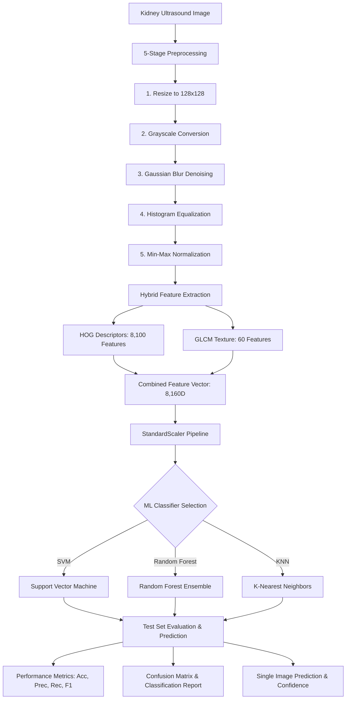

# KIDNEY DISEASE IMAGE CLASSIFICATION USING MACHINE LEARNING

> **Academic & Educational Machine Learning Mini-Project**  
> *Demonstrating the Complete End-to-End Traditional ML & Computer Vision Pipeline for Ultrasound Image Analysis.*

---

## ⚠️ Important Medical Safety Disclaimer

> **Educational Notice:** This application is developed strictly for academic, educational, and research demonstration purposes. It is **NOT** a certified medical device and must **NEVER** be used for clinical diagnosis, patient screening, pathology confirmation, or treatment planning. All model outputs and confidence scores represent algorithmic feature classifications based on training distributions, not medical facts. Always consult qualified healthcare professionals for medical evaluation.

---

## 1. Project Title & Objective

**Title:** Kidney Disease Image Classification Using Machine Learning  
**Objective:** To build a transparent, interactive, and modular educational web application that demonstrates every phase of a classical Machine Learning computer vision pipeline:
1. **Input & Exploration:** Loading kidney ultrasound images and multi-class dataset directory structures.
2. **5-Stage Preprocessing:** Spatial standardization, grayscale conversion, Gaussian blur noise filtering, histogram equalization contrast enhancement, and intensity normalization.
3. **Hybrid Feature Extraction:** Extracting 8,160 numerical descriptors combining **HOG** (Histogram of Oriented Gradients) edge orientations and **GLCM** (Gray-Level Co-occurrence Matrix) second-order statistical texture properties.
4. **Machine Learning Modeling:** Training and evaluating classical classifiers (**SVM**, **Random Forest**, and **KNN**) within a Scikit-Learn `StandardScaler` pipeline.
5. **Rigorous Evaluation:** Real-time calculation of Accuracy, Weighted Precision, Recall, F1-Score, Confusion Matrix heatmaps, and per-class reports.
6. **Inference & Testing:** Real-time single-image upload and prediction with confidence estimation.

---

## 2. Key Features

- **All-in-One Dashboard:** Interactive Streamlit web interface with dedicated tabs for Overview, Dataset, Preprocessing Lab, Feature Extraction, Model Training, Performance Evaluation, and Prediction.
- **Traditional Machine Learning Focus:** Eliminates deep learning black-boxes in favor of interpretable, mathematically grounded feature descriptors and classical classifiers.
- **Dynamic Dataset Support:** Auto-detects class folders (`Normal`, `Cyst`, `Stone`, `Tumor`, or any custom classes like `Normal`/`Abnormal`).
- **Synthetic Demo Data Generator:** Built-in generator creating realistic synthetic ultrasound scans for immediate out-of-the-box UI demonstration without requiring large dataset downloads.
- **Interactive Visualizations:** Pixel histograms before and after equalization, HOG vector fields, GLCM property bar charts, Seaborn confusion matrix heatmaps, and confidence distribution graphs.
- **Model Persistence & Artifact Export:** Serializes trained pipelines via `joblib` and exports publication-ready confusion matrix images and classification report CSV files.

---

## 3. Technology Stack

| Layer | Technologies |
|---|---|
| **Frontend / Web UI** | Streamlit (Python) |
| **Programming Language** | Python 3.10+ |
| **Machine Learning** | Scikit-Learn (`sklearn`) |
| **Image Processing** | OpenCV (`cv2`), Pillow (`PIL`), NumPy |
| **Feature Extraction** | Scikit-Image (`skimage.feature.hog`, `skimage.feature.graycomatrix`, `graycoprops`) |
| **Data & Scientific Computing** | Pandas, NumPy, SciPy |
| **Data Visualization** | Matplotlib, Seaborn |
| **Model Serialization** | Joblib |

---

## 4. System Architecture



---

## 5. Folder Structure

```
Kidney Disease Image Classification/
│
├── app.py                     # Master Streamlit web application dashboard
├── train_model.py             # Standalone CLI training & evaluation script
├── preprocessing.py           # 5-stage digital image preprocessing pipeline
├── feature_extraction.py      # HOG edge gradients & GLCM texture extraction
├── model_training.py          # SVM, Random Forest, KNN pipeline training & Joblib saving
├── evaluation.py              # Metrics, confusion matrix heatmap & report export
├── prediction.py              # Single-image inference pipeline with safety disclaimers
├── utils.py                   # Dataset loader, scanner, train/test split & demo data generator
├── requirements.txt           # Python library dependencies
├── README.md                  # Comprehensive project documentation
├── PROJECT_DOCUMENTATION.md   # Academic project report and theoretical analysis
├── .gitignore                 # Git ignore rules
│
├── dataset/                   # Dataset root (auto-detected folders)
│   ├── Normal/                # Normal kidney ultrasound scans
│   ├── Cyst/                  # Renal cyst ultrasound scans
│   ├── Stone/                 # Kidney stone / nephrolithiasis scans
│   └── Tumor/                 # Renal tumor / mass ultrasound scans
│
├── sample_images/             # Dedicated test images for single-image upload testing
│   ├── test_normal_ultrasound.png
│   ├── test_cyst_ultrasound.png
│   ├── test_stone_ultrasound.png
│   └── test_tumor_ultrasound.png
│
├── models/                    # Saved trained model bundles
│   └── kidney_model.pkl       # Serialized Joblib pipeline bundle
│
└── outputs/                   # Generated evaluation artifacts
    ├── confusion_matrix.png   # Seaborn confusion matrix heatmap image
    └── classification_report.csv # Precision/Recall/F1 CSV table
```

---

## 6. Dataset Format & Organization

The system automatically scans and indexes any folder-based image dataset structure:

```
dataset/
    <Class_1_Name>/
        image_001.jpg
        image_002.png
        ...
    <Class_2_Name>/
        image_001.jpg
        ...
```

### Supported Image Formats:
- `.jpg`, `.jpeg`, `.png`, `.bmp`, `.tif`, `.tiff`

### Flexible Class Adaptation:
- **4 Classes:** `Normal`, `Cyst`, `Stone`, `Tumor`
- **2 Classes (Binary):** `Normal`, `Abnormal`
- **Arbitrary Classes:** Any custom multi-class naming structure.

---

## 7. Installation & Setup

### Prerequisites:
- Python 3.10, 3.11, 3.12, 3.13, or 3.14
- Git (optional)

### Step 1: Clone or Navigate to Project Directory
```powershell
cd "c:\Users\Lenovo\OneDrive\Desktop\Kidney Disease Image Classification"
```

### Step 2: Create a Virtual Environment
**On Windows (Command Prompt / PowerShell):**
```powershell
python -m venv venv
```

### Step 3: Activate the Virtual Environment
**On Windows:**
```powershell
venv\Scripts\activate
```

### Step 4: Install Dependencies
```powershell
pip install -r requirements.txt
```

---

## 8. How to Run the Application

Launch the Streamlit dashboard using either command:

```powershell
streamlit run app.py
```

*Or (if `streamlit` is not directly on system PATH):*
```powershell
python -m streamlit run app.py
```

The application will launch in your browser at `http://localhost:8501`.

---

## 9. How to Train Models

### Option A: From the Web UI
1. Navigate to the **📊 Dataset Explorer** tab and click **🚀 Load & Extract Dataset Features**.
2. Switch to the **🤖 Model Training** tab.
3. Select your algorithm (**SVM**, **Random Forest**, or **KNN**).
4. Click **🚀 Train Model Now**.
5. Switch to the **📈 Performance Evaluation** tab to inspect metrics.

### Option B: From the Command Line (CLI)
Train from terminal using `train_model.py`:

```powershell
# Train default SVM model
python train_model.py --algorithm SVM

# Train Random Forest model
python train_model.py --algorithm "Random Forest"

# Train KNN model
python train_model.py --algorithm KNN

# Generate synthetic demo data if dataset directory is empty:
python train_model.py --algorithm SVM --generate-demo-data
```

---

## 10. How Image Preprocessing Works

Ultrasound imaging is characterized by speckle noise (Rayleigh-distributed acoustic interference) and low contrast. Preprocessing standardizes the visual input:

1. **Spatial Resizing:** Interpolates images to standard $128 \times 128$ resolution using bilinear interpolation:
   $$\text{Output Shape} = (128, 128)$$
2. **Grayscale Conversion:** Converts 3-channel RGB to luminance $Y$:
   $$Y = 0.299 \cdot R + 0.587 \cdot G + 0.114 \cdot B$$
3. **Gaussian Blur Noise Reduction:** Convolves image with a $5 \times 5$ Gaussian kernel to smooth high-frequency speckle noise without destroying anatomical margins:
   $$G(x, y) = \frac{1}{2\pi\sigma^2} e^{-\frac{x^2+y^2}{2\sigma^2}}$$
4. **Histogram Equalization:** Spreads out the most frequent intensity values across the entire range $[0, 255]$, enhancing low-contrast ultrasound tissue boundaries:
   $$s_k = T(r_k) = (L - 1) \sum_{j=0}^{k} p_r(r_j)$$
5. **Min-Max Normalization:** Scales pixel intensities to $[0.0, 1.0]$ float32:
   $$I_{\text{norm}}(x, y) = \frac{I(x, y) - I_{\min}}{I_{\max} - I_{\min}}$$

---

## 11. How Feature Extraction Works

### A. Histogram of Oriented Gradients (HOG)
- **Concept:** Captures structural edges, contours, and shape gradients invariant to illumination.
- **Parameters:**
  - Orientations: $9$ directional bins ($0^\circ - 180^\circ$)
  - Pixels per cell: $8 \times 8$ pixels ($16 \times 16 = 256$ cells)
  - Cells per block: $2 \times 2$ cells ($15 \times 15 = 225$ blocks)
  - Block normalization: `L2-Hys` (L2 norm with clipping)
- **Calculations:**
  $$\text{Features} = 225 \text{ blocks} \times (2 \times 2 \text{ cells/block}) \times 9 \text{ bins} = 8,100 \text{ features}$$

### B. Gray-Level Co-occurrence Matrix (GLCM)
- **Concept:** Computes second-order joint probability distributions $P(i, j | d, \theta)$ of gray-level pairs at distance $d$ and angle $\theta$.
- **Parameters:**
  - Distances: $d \in \{1, 2, 3\}$ pixels
  - Angles: $\theta \in \{0^\circ, 45^\circ, 90^\circ, 135^\circ\}$
- **Extracted Statistical Properties:**
  1. **Contrast:** $\sum_{i,j} |i - j|^2 P(i, j)$
  2. **Dissimilarity:** $\sum_{i,j} |i - j| P(i, j)$
  3. **Homogeneity:** $\sum_{i,j} \frac{P(i, j)}{1 + |i - j|^2}$
  4. **Energy (Angular Second Moment):** $\sum_{i,j} P(i, j)^2$
  5. **Correlation:** $\sum_{i,j} \frac{(i - \mu_i)(j - \mu_j) P(i, j)}{\sigma_i \sigma_j}$
- **Calculations:**
  $$\text{Features} = 5 \text{ properties} \times 3 \text{ distances} \times 4 \text{ angles} = 60 \text{ features}$$

### C. Total Feature Vector
$$\text{Vector Length} = 8,100 \text{ (HOG)} + 60 \text{ (GLCM)} = 8,160 \text{ numerical features}$$

---

## 12. Machine Learning Algorithms

### 1. Support Vector Machine (SVM)
- **Mechanism:** Constructs maximum-margin separating hyperplanes in high-dimensional kernel space.
- **Kernel:** Radial Basis Function (RBF):
  $$K(x_i, x_j) = \exp(-\gamma ||x_i - x_j||^2)$$
- **Optimization:** Soft-margin convex quadratic optimization with parameter $C$.
- **Probability:** Calibrated via Platt scaling (`probability=True`).

### 2. Random Forest Classifier
- **Mechanism:** Ensemble of $100$ decorrelated decision trees using Bootstrap Aggregation (Bagging) and random feature subspace selection.
- **Split Criterion:** Gini Impurity:
  $$I_G(p) = 1 - \sum_{i=1}^{C} p_i^2$$
- **Strengths:** Robust to noise, high dimensional stability, non-linear feature interaction modeling.

### 3. K-Nearest Neighbors (KNN)
- **Mechanism:** Instance-based non-parametric classifier. Assigns majority class label among $k=5$ closest training vectors in standardized Euclidean space:
  $$d(x, y) = \sqrt{\sum_{i=1}^{n} (x_i - y_i)^2}$$

---

## 13. Performance Evaluation Metrics

- **Accuracy:** Proportion of correctly classified ultrasound samples:
  $$\text{Accuracy} = \frac{TP + TN}{TP + TN + FP + FN}$$
- **Weighted Precision:** Proportion of true positives among all positive predictions:
  $$\text{Precision} = \frac{TP}{TP + FP}$$
- **Weighted Recall (Sensitivity):** Proportion of true positives identified from all true cases:
  $$\text{Recall} = \frac{TP}{TP + FN}$$
- **Weighted F1-Score:** Harmonic mean of precision and recall:
  $$\text{F1-Score} = 2 \cdot \frac{\text{Precision} \times \text{Recall}}{\text{Precision} + \text{Recall}}$$
- **Confusion Matrix:** $N \times N$ matrix displaying exact True Class vs. Predicted Class counts and percentages.

---

## 14. Troubleshooting Guide

| Issue | Cause | Solution |
|---|---|---|
| `streamlit is not recognized` | Streamlit is not on system PATH | Run `python -m streamlit run app.py` |
| `Found less than 2 classes` | Dataset folder is missing class folders | Click **"Generate Demo Dataset"** in sidebar or verify folder structure |
| `No module named ...` | Virtual environment missing dependencies | Run `pip install -r requirements.txt` |
| Unicode character error in terminal | Windows terminal default code page | Updated in code to use ASCII progress indicators |
| Model file not found | No model has been trained yet | Train a model via Tab 5 or run `python train_model.py` |

---

## 15. Educational License & Disclaimer

This project is released strictly for academic mini-project demonstration and non-commercial educational study. It does not replace professional medical imaging systems.
